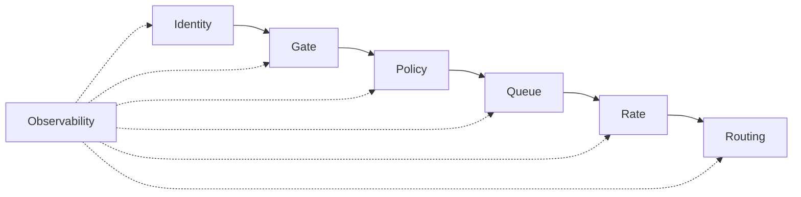

# Governance & Attribution — Synthesis

**Date:** 2026-09-15
**Author:** GitHub Copilot agent (main session)
**Status:** active
**Tags:** #interpretation #governance #synthesis #distilled

The distilled knowledge from the governance & attribution research (70+ docs). Written for a reader who has NOT read the source docs.

---

## Verdict

**9router has the foundation but not the governance layer.** Attribution is partially built (source-app fingerprinting, task classification, usage capture, SQLite persistence). Control is entirely missing (no per-key limits, budgets, allowlists, queues, gates, or guardrails). The research maps exactly what to build and where, validated by industry precedents (OpenRouter, Anthropic, LiteLLM).

---

## Key Findings

### 1. Attribution ("where from") — partially built
- `src/lib/sourceApps.js` — 24 UA rules, most-specific-first, 300-char cap, `DEFAULT_APP = "unknown"`, `addSourceAppRule()`.
- Smart-router task classification — 16 task types, FNV-1a conversation fingerprints, sticky sessions (5-min TTL).
- Usage capture — `usageDb.js` → SQLite, per-request meta.
- **Missing:** trusted identity headers (X-9R-App/User/Session), key metadata (name/owner/tags), Sources dashboard view.

### 2. Control ("where to") — entirely missing
- Rate limiter is per-IP only (`custom-server.rate-limiter.js`: general 120/min, chat 20/min, loopback bypass).
- **Missing:** per-key RPM/TPM, per-model limits, budgets (USD), allowlists, queues, gates, guardrails, response headers.

### 3. Keyless-first is viable
- Loopback + trusted subnets + UA fingerprinting + agent profiles can gate requests without keys.
- Hybrid resolution order: **key → trusted subnet → loopback → default profile**.
- Keys remain the strongest identity for control (per-key limits/budgets/allowlists).

### 4. Industry precedents validate the design
- **OpenRouter:** app attribution (X-App header, openrouter_metadata), guardrails (hierarchy, budgets, regex constraints, 403 semantics), BYOK.
- **Anthropic:** RPM/ITPM/OTPM tier limits, spend-cap 429 semantics, workspaces (wrkspc_ keys, anthropic-workspace-id header), identity-backed keys (WIF/App Attest).
- **LiteLLM:** virtual keys, teams, shared budgets, model groups (model_group field).

### 5. Privacy is preserved by design
- Hash-only synthetic labels: `hash(uaClass + ipPrefix + sessionId)` (FNV-1a, salted with MACHINE_ID_SALT).
- Never store raw UAs (300-char cap, classify-then-discard).
- IP prefixes only (/24, /48), never full IPs.

---

## Recommended Architecture

### 7-Layer Governance Model (from research §H)

| Layer | Role | Key components |
|-------|------|----------------|
| Identity | Resolve who/what is calling | UA fingerprint, headers, key metadata, synthetic labels |
| Gate | Decide access level | L0–L5 ladder, highest-cleared-level-wins |
| Policy | Decide what's allowed | Allowlists, budgets, guardrails |
| Queue | Manage overload | Priority classes, bounded FIFO, TTL, backpressure |
| Rate | Control throughput | Token bucket, AIMD/EWMA adaptive, budget-proportional pacing |
| Routing | Decide where to send | Provider/model selection, combo fallback |
| Observability | Record everything | Usage, logs, dashboard views |

### Keyless-First Principle
- Loopback (127.0.0.1, ::1) → trusted implicitly (L1).
- Trusted subnets (configurable CIDRs) → trusted (L2).
- API keys → strongest identity (L3).
- Agent profiles → identity + policy bundle (L4).
- Full auth (JWT session) → full control (L5).

---

## Design Decisions

| # | Decision | Rationale |
|---|----------|-----------|
| 1 | Keyless-first (keys optional for access, required for control) | Local-first tool; loopback is trusted |
| 2 | Hash-only synthetic labels | Privacy; never store raw UA/IP/prompt |
| 3 | Token-bucket rate limits (per-key + per-app) | Burst tolerance + fairness |
| 4 | Bounded priority queue (opt-in per key) | Backpressure instead of hard 429 |
| 5 | Tag/keyword → priority class mapping | Simple, configurable prioritization |
| 6 | Model groups share RPM/TPM budgets | 9 qwen models under one cap |
| 7 | AIMD + EWMA + 429 feedback adaptive rate | Self-tuning to upstream signals |
| 8 | Gate levels L0–L5, highest-cleared-wins | Progressive trust ladder |
| 9 | Budget-proportional pacing (remaining_budget/remaining_seconds) | Even spend across period |
| 10 | 7-layer architecture, observability cross-cutting | Clean separation + full visibility |

---

## Open Questions

1. Which milestone ships first? (M1 attribution is the foundation — recommended.)
2. Should profiles be user-editable JSON or DB-backed?
3. Default gate level for production? (L1 loopback recommended.)
4. Default retention period for synthetic labels?
5. Strict priority vs WFQ as the queue default?
6. Should response headers be IETF-standard (x-ratelimit-*)?

---

## Confidence Levels

| Area | Confidence | Basis |
|------|-----------|-------|
| Codebase inventory (T1–T6, E01–E06) | **High** | Direct code reads |
| Industry models (T7–T13, E07–E13) | **High** | Live doc fetches (OpenRouter, Anthropic, LiteLLM) |
| Design space (T14–T18, E14–E18) | **High** | Synthesis of codebase + industry |
| Keyless governance (T19–T26, E19–E26) | **High** | Synthesis of all research |
| Implementation details | **Medium** | Reference code in plan is a starting point, not final |

---

## Sources

- `../research/2026-08-31-message-origin-and-destination-research.md`
- `../research/2026-09-14-keyless-governance-research.md`
- `../research/2026-09-15-master-research-tree.md` + 16 branch docs
- `../research/2026-09-15-master-topic-index.md` + 26 tree docs
- `../research/2026-09-15-exponential-master-map.md` + 26 expansion docs
- `../planning/2026-08-31-source-app-governance-plan.md`
- `../planning/2026-09-14-keyless-governance-plan.md`
- `../planning/2026-09-15-governance-implementation-plan.md` (code-bearing)