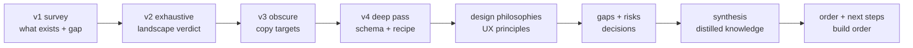

# Message Capture & Log-Viewing — Doc-by-Doc

**Date:** 2026-09-15
**Author:** GitHub Copilot agent (main session)
**Status:** active
**Tags:** #interpretation #messages #observability #doc-by-doc

> Plain-language summary of **every** message-capture research doc: what it is, what it covers, key takeaways, how it fits, what to read next.

---

## 1. `../research/message-capture-log-viewing.md` (v1 — the survey)

**What it is:** The first pass. Audits what 9Router already has and surveys the open-source landscape at a high level.

**What it covers:**
- **What exists today:** `requestDetails` table (one row per request/response pair: id, timestamp, provider, model, connectionId, status, conversationId, data JSON blob); capture pipeline with buffered writes, header sanitization (Authorization/Cookie stripped), truncation guard; Usage → Request Details tab with filters + AI Error Analysis button; export (JSON/markdown); markdown auto-log; Console Log page.
- **The gap vs the user's wishlist:** no dedicated Messages page; no agent/profile/location/project capture; limited filters; no conversation tree; no raw/pretty format toggles; no copy-to-log; no error inbox; no notifications; no synthetic scan.
- **Landscape:** Langfuse, Helicone, OpenObserve, SigNoz, Loki+Grafana as the closest turnkey systems.

**Key takeaways:**
- Capture is **done**; the **viewing layer** is the missing piece.
- Recommendation: build the in-app Messages tab first; keep Langfuse/OpenObserve as optional export later.

**How it fits:** The foundation doc — defines the gap that all later passes deepen.

**Read next:** `message-capture-deep-research-v2.md` (the exhaustive pass).

---

## 2. `../research/message-capture-deep-research-v2.md` (v2 — the exhaustive pass)

**What it is:** The deep dive. Every project pulled from live GitHub (stars/licenses verified), ProxmoxVE repo enumerated, awesome-lists read.

**What it covers:**
- **LLM observability platforms:** Langfuse (MIT, best ship-out target), Helicone (Apache-2.0, gateway+viewer = same as 9Router), Phoenix (ELv2 — skip), Weave, AgentOps, OpenLIT (exceptions dashboard + coding-agent CLI hooks), Langtrace, LangWatch (ELv2), TruLens, OpenLLMetry, WhyLabs, promptfoo, DeepEval, Opik.
- **AI gateways with built-in log viewers:** one-api (MIT, `logs` table viewer), new-api (AGPL), LiteLLM, Portkey, Bifrost, Kong, Envoy, Higress, TensorZero (archived — skip), OmniRoute (42.4k★, coding-agent token-saver, close cousin).
- **Log management:** OpenObserve (AGPL, single binary), SigNoz, Loki, VictoriaLogs, Quickwit, Graylog (SSPL — avoid), ELK, HyperDX (property search `level:err`), Highlight.io, Logdy, lnav, Dozzle.
- **Error tracking:** Sentry self-host (FSL — heavy), GlitchTip (MIT, accepts Sentry protocol), Exceptionless, Errbit (fingerprint = hash).
- **Notifications:** ntfy, Gotify, Apprise (one URL per channel, 100+ services), Novu.

**Key takeaways:**
- **Build in-app, copy proven UX, integrate nothing heavy.**
- Copy: Bruno/Hoppscotch response tabs, mitmweb master-detail, OpenObserve histogram + field filters, HyperDX property search, Sentry grouping/triage.
- Avoid: Graylog (SSPL), Sentry self-host (FSL + 20 containers), Phoenix (ELv2), Axiom (self-host discontinued), Pipedream, TensorZero (archived).

**How it fits:** The verdict doc — establishes the build-in-app strategy.

**Read next:** `message-capture-obscure-projects-v3.md` (hidden gems).

---

## 3. `../research/message-capture-obscure-projects-v3.md` (v3 — the hidden gems pass)

**What it is:** The "under-the-radar" pass targeting 20–1,500★ projects, per the user's directive to find obscure options.

**What it covers:**
- **Wire/proxy-level capture:** cc-viewer (1,058★, MIT — per-conversation dirs, body-diff), tokentap (811★, MIT — markdown+JSON dual export, context gauge), llm-proxy (27★), Spanlens (11★), SectorFlux (7★), CliRelay (893★ — a mini-9Router), control-layer.
- **Session/transcript viewers:** agent-sessions (762★), claude-code-viewer (1,267★), claude-code-trace (362★ — **3-panel layout: session tree → turns → detail**), codex-trace (collaboration chains), cc-sessions-viewer (global search ⌘⇧F), claude-trace-replay (session compare), AI-Session-Viewer, recensa (69★ — **SQLite FTS5 search with snippets**), claudex (92★ — FTS5 + MCP API), chatgpt-json-tree-viewer (branching tree).
- **Cost/token dashboards:** TokenTracker, token-dashboard (turn-by-turn view), logfire, RagaAI-Catalyst, llm.report (archived, GPL — pattern only).

**Key takeaways:**
- The **3-panel layout** (claude-code-trace) is the canonical copy for the Messages page.
- **FTS5 search with snippet highlighting** (recensa/claudex) is the search pattern.
- **Body-diff collapsing** (cc-viewer) is a great UX for long agent sessions.
- License check: copy ideas from MIT/Apache-2.0 only; GPL/AGPL projects are pattern-only.

**How it fits:** The copy-target doc — specific UX patterns to steal.

**Read next:** `message-capture-v4-deep-pass.md` (the deep pass).

---

## 4. `../research/message-capture-v4-deep-pass.md` (v4 — the deep pass)

**What it is:** The "no limits" pass: ~90 new projects, 43 academic papers, community landscape, storage-pattern synthesis.

**What it covers:**
- **New projects:** latitude-llm (error clustering), evidently (drift), plano (competitor layout), axonhub (trace timelines), GoModel (real-time log stream), otari (quota ledger), promptflow, BricksLLM (dead), voidllm (privacy-preserving), error-monitoring-agent (cluster → enrich → alert recipe), HolmesGPT (LLM RCA), Axon (OTel CLI), kitaru (record → replay), smithers (time-travel viewer), token-monitor, tokencost (pricing table), agentacct, tokentelemetry.
- **43 academic papers:** surveys, routing reliability, log/error analysis, privacy (prompt injection "When AIOps Become AI Oops"), HCI.
- **Community:** HN threads, GitHub issue demand signals, Discords; Reddit IP-blocked (search links provided).
- **Storage-pattern synthesis:** the definitive conversation-schema recommendation — **hybrid relational**: `messages` projection table (indexed columns) + fat JSON stays in `requestDetails.data` (LangGraph-blob style).

**Key takeaways:**
- The **error-inbox recipe**: cluster → enrich → alert (airweave-ai).
- The **schema is settled**: hybrid relational (D2 in gaps doc).
- Privacy papers confirm: sanitize before AI analysis; never auto-close without human confirmation.

**How it fits:** The depth doc — schema synthesis + error-inbox recipe + academic grounding.

**Read next:** `message-viewer-design-philosophies.md` (design principles).

---

## 5. `../research/message-viewer-design-philosophies.md` (design philosophies)

**What it is:** Distills design philosophies from 10 reference tools (Sentry, Datadog, LangSmith, Langfuse, Helicone, OpenRouter, OpenAI SDK, Grafana Loki) + 9Router codebase audit.

**What it covers:**
- **A. Design philosophies:** Sentry Issue Details (3-zone layout, fingerprint grouping, `key:value` search, Event Highlights, breadcrumbs, frequency chart); Datadog Log Explorer (facets-left + query-bar + results + histogram, saved views, `key:value` query language with ranges); LangSmith/Langfuse (LLM traces).
- **B. Filter dimensions:** session, trace, user, project, model, cost, latency, tags, metadata, environment — and where each is captured.
- **C. Gateway-only dimensions:** API key used, client IP + UA, combo name, smart-router task type, fallback chain, provider account, custom headers, conversation, route — **no client-side tool can see these**.
- **D. Recommendations:** 3 distinct view designs, 5+ additional filters buildable today, 5 visual/UX improvements, privacy/risk guardrails.

**Key takeaways:**
- 9Router's unique advantage: it's a **gateway** — it captures dimensions from the wire that client-side SDK instrumentation can't.
- The histogram is the primary navigation primitive (Datadog).
- Saved views = search query + columns + time horizon (shareable, URL-serializable).

**How it fits:** The design doc — what the Messages page should look like and filter on.

**Read next:** `message-capture-gaps-and-risks.md` (risks + decisions).

---

## 6. `../research/message-capture-gaps-and-risks.md` (gap analysis + risk register)

**What it is:** The risk register + decision log for the Messages page + error inbox implementation.

**What it covers:**
- **Research blind spots:** Reddit demand signals (IP-blocked — verify manually), OTel semconv churn (freeze a minimal subset), Langfuse/Helicone maintenance risk (format references only), TensorZero-archived lesson (keep export platform-agnostic), GPL/AGPL license traps (study UI, never vendor code), dead projects worth pattern-only study.
- **10 implementation risks:** R1 performance at scale (keyset pagination, lazy join), R2 storage growth (maxJsonSize caps, retention janitor), R3 privacy/prompt injection (sanitize before AI analysis), R4 streaming capture gaps (EOF misclassification), R5 role-based access (ship under existing auth), R6 DB driver variance (FTS5 capability probe), R7 migration risk (additive-only), R8 concurrency (single-writer discipline), R9 UI complexity (2-panel default, 3-panel opt-in), R10 analyzer trust (advisory-only, never auto-close).
- **7 open decisions:** D1 FTS5 vs LIKE (both, runtime probe), D2 new `messages` table vs extending `requestDetails` (**new projection table** — settled), D3 webhook vs in-app notifications first (in-app first), D4 synthetic scan model (local-first, off by default), D5 IP/agent/project capture timing (P3, additive migration now), D6 retention strategy (raw N days → aggregated forever), D7 labeled failure corpus (seed synthetic, harvest real).

**Key takeaways:**
- The schema decision (D2) is **settled**: new `messages` projection table.
- Privacy (R3) is the highest-stakes risk — sanitize before any AI analysis.
- FTS5 with LIKE fallback (D1) is the search approach.

**How it fits:** The risk doc — read before implementing.

**Read next:** `2026-09-15-message-capture-synthesis.md` (distilled knowledge).

---

## How the 6 docs fit together

