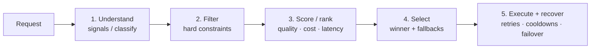

# How AI Model Routers Choose the Best Model — Deep Research

**Date:** 2026-09-14
**Author:** GitHub Copilot (research agent)
**Status:** active
**Tags:** #research #routing #llm #model-selection #9router #routerbench #routellm #litellm #openrouter #clawrouter

## Question / objective

How does an AI model router decide *which* model to use for a given request? What are all the
mechanisms — learned, heuristic, market-driven, constraint-based — and how do real products and
open-source projects implement them? Research to a reference depth of 5 nodes per branch, with
each branch explored as deeply as sources allow.

## Sources consulted

### Academic papers (full or abstract)
- RouteLLM — arXiv:2406.18665 (full paper + repo lm-sys/RouteLLM)
- RouterBench — arXiv:2403.12031 (FULL paper, ICML 2024, Martian + UC Berkeley + UCSD)
- FrugalGPT — arXiv:2305.05176 (abstract)
- Hybrid LLM — arXiv:2404.14618 (abstract, ICLR 2024)
- AutoMix — arXiv:2310.12963 (abstract, NeurIPS 2024)
- Shnitzer et al., "Large Language Model Routing with Benchmark Datasets" — arXiv:2309.15789 (IBM Research; correct ID found via arXiv API after 2307.15793 proved to be an unrelated meeting-recap paper)
- Tryage — arXiv:2308.11601 (Hari & Thomson 2023; correct ID found via arXiv API after 2308.00352 proved to be MetaGPT)

### Products / open-source projects
- 9Router (this repo) — full codebase mapping, 16 decision points
- OpenRouter Auto Router — full official docs (openrouter.ai/docs/guides/routing/routers/auto-router)
- LiteLLM — routing docs + repo (BerriAI/litellm, 58.7k★)
- ClawRouter — full README (BlockRunAI/ClawRouter, 6.6k★)
- vLLM Semantic Router — repo + docs intro + signal-driven routing pipeline (vllm-project/semantic-router, 5.8k★)
- semantic-router — repo (aurelio-labs/semantic-router, 3.9k★)
- coai — README (coaidev/coai, 9.3k★)
- Martian — site + docs (pivoted to research lab; gateway docs only)
- GitHub search: 2,727 results, top 12 repos reviewed (Switchyard, freellmapi, GoModel, WayfinderRouter, kcolemangt/llm-router, RelayFreeLLM, DEEIX-Chat, wesight, NVIDIA llm-router, etc.)
- Unify AI — pivoted ("Bridging symbolic reasoning and continual learning"), no router docs available

## Raw findings

### 1. The core decision problem

Every router answers one question: **given a request, which model (or model path) maximizes
value?** "Value" decomposes into quality, cost, latency, reliability, and hard constraints
(capability, context window, modality, locality, policy). The research shows routers differ in:

1. **What they predict** — win probability vs. a strong model (RouteLLM), task type (OpenRouter,
   9Router), difficulty (Hybrid LLM), correctness of a cheap model's answer (AutoMix), raw
   performance score (RouterBench KNN/MLP), or nothing at all (market share, heuristics).
2. **How they learn** — preference data (RouteLLM), benchmark labels (Shnitzer, RouterBench),
   self-verification (AutoMix), or no learning (OpenRouter, coai, LiteLLM strategies).
3. **What they optimize** — cost at fixed quality (RouteLLM α threshold), quality at fixed cost
   (RouterBench AIQ), user-tunable quality/cost tradeoff (Hybrid LLM, ClawRouter profiles,
   9Router costQualityTradeoff), or reliability (LiteLLM cooldowns, 9Router fallback chains).

### 2. Learned routers (predictive)

**RouteLLM (lm-sys, arXiv:2406.18665)** — the canonical learned router. Trained on 80k Chatbot
Arena battles clustered into 10 model tiers. Four router types:

- **Matrix Factorization (MF)**: predicts win probability of model m over model m′ for query q as
  $\delta(m, q) = w_2^T (v_m \odot (W_1^T v_q + b))$ — a bilinear form over model and query
  embeddings. Best cost/performance tradeoff: $3.32/M requests at 155 req/s.
- **Similarity-Weighted (SW) ranking**: Bradley-Terry model with cosine-similarity weights
  between query and training queries. $39.26/M at 2.9 req/s.
- **BERT classifier**: $\sigma(W h_{CLS} + b)$ over a small BERT encoder. $3.19/M at 69.6 req/s.
- **Causal LLM classifier**: Llama 3 8B. $5.23/M at 42.5 req/s.

Decision: route to the strong model iff predicted win probability ≥ threshold α; α is calibrated
via `python -m routellm.calibrate_threshold --routers mf --strong-model-pct 0.5` (e.g., "use the
strong model 50% of the time"). Key insight: **routers trained on preference data generalize
across model pairs without retraining** — the router learns "when is the weak model good enough,"
not "which model wins." Up to 85% cost reduction at 95% of GPT-4 MT-Bench performance. Data
augmentation (golden labels D_gold from MMLU, GPT-4-as-judge D_judge on Nectar, ~$700) is
critical for out-of-distribution performance.

**RouterBench (arXiv:2403.12031)** — the evaluation framework that made router comparison
rigorous. 405,467 samples, 11 models, 8 datasets, 64 tasks. Contributions:

- **Cost-quality (c−q) plane**: every router is a point; linear interpolation (probabilistic mix
  of two routers) and extrapolation (null router at (0,0)) make the plane convex.
- **AIQ (Average Improvement in Quality)** = $\frac{1}{c_{max}-c_{min}} \int R_\theta~ dc$ — a
  single scalar for router comparison.
- **Zero router**: the probabilistic mix of LLMs on the non-decreasing convex hull (NDCH) that
  maximizes expected quality at each cost — the baseline any router must beat.
- **Oracle router**: always picks the best-performing model (cheapest on ties). Near-optimal at
  low cost; GPT-4 is *seldom* chosen — cheaper models suffice for most queries.
- **Predictive routers**: KNN (40 neighbors, all-MiniLM-L12-v2, cosine) and MLP (2×100 ReLU,
  lr 0.001) with performance score $score_{ij} = \lambda P_{ij} - cost_j$ (λ = willingness to
  pay). **Neither significantly beats the Zero router** — simple learned routers are not magic.
- **Cascading router**: LLMs ranked least→most expensive, judge g:text→[0,1] with threshold t and
  error ε. With judge error ≤ 0.1 it beats Zero significantly and approaches Oracle; performance
  collapses when judge error > 0.2. **Judge quality is the bottleneck.**
- **RAG finding**: routers learn time-sensitivity (e.g., "2024" in query → route to online model
  sonar-medium-online). Costs vary 2–5× for comparable performance.

**Shnitzer et al. (arXiv:2309.15789, IBM)** — repurposes benchmark datasets to learn a router;
reduces LLM selection to a collection of binary classification tasks ("is model A better than
model B on this input?"). Consistently beats using any single model for all tasks.

**Tryage (arXiv:2308.11601)** — context-aware routing inspired by the brain's thalamic router.
A perceptive router predicts downstream model performance per prompt, then an objective function
integrates predictions with user goals via flags (model size, recency, security, verbosity,
readability). Users explore a Pareto front trading accuracy against secondary goals. 50.9%
optimal-model-selection accuracy vs 23.6% (GPT-3.5 Turbo) and 10.8% (Gorilla).

**AutoMix (arXiv:2310.12963, NeurIPS 2024)** — routes to larger LMs based on the *approximate
correctness* of a smaller LM's output. Two contributions: (1) few-shot self-verification
estimating reliability of own outputs without training; (2) a **POMDP-based router** selecting
model size from answer confidence (self-verification is noisy, so the router treats it as a
partially observable state). >50% cost reduction at comparable performance across 5 models and 5
datasets.

**FrugalGPT (arXiv:2305.05176)** — three strategies: prompt adaptation, LLM approximation, LLM
cascade. Matches GPT-4 with up to 98% cost reduction.

**Hybrid LLM (arXiv:2404.14618, ICLR 2024)** — router assigns queries to small or large model
based on **predicted query difficulty** and a **desired quality level** tunable at test time
(seamless quality↔cost tradeoff). Up to 40% fewer large-model calls with no quality drop.

### 3. Semantic / intent routers

**aurelio-labs/semantic-router (3.9k★, MIT)** — a "superfast decision layer" using semantic
vector space. Routes are defined as name + utterance examples; an encoder (Cohere, OpenAI, HF,
FastEmbed) embeds the query; nearest route wins or returns None. Pure classification — no cost
or capability awareness.

**vLLM Semantic Router (5.8k★, Apache-2.0, v0.3.0 "Themis")** — "Make your Mixture-of-Models
programmable." A full routing pipeline with six layers:

1. **Signals** — extract facts (deterministic: keyword, metadata predicate, context-length band;
   learned: embeddings/classifiers for intent, domain, complexity, PII, jailbreak). Signals
   describe facts; they do not choose the backend.
2. **Projections** — combine signals into reusable results (partition picks a coherent winner
   among overlapping matches; score combines weighted inputs; mapping converts score to named
   routing bands).
3. **Decisions** — boolean rules over signals + projections; priority + recipe strategy decide
   which matching route wins. **Hard requirements (authorization, modality, context capacity,
   tool compatibility) make a route eligible/ineligible BEFORE an optimizer compares cost or
   latency** — the constraint-first pattern.
4. **Algorithms** — selection (fixed order, semantic fit, latency, feedback) or coordination
   (cascade, panel, multi-round, workflow).
5. **Plugins** — route-specific behavior (parameter changes, context compression, retrieval,
   memory, replay, caching, response controls). Detection ≠ enforcement (PII signal reports;
   policy decides block/reroute/transform/observe).
6. **Model pools** — providers bind logical names to physical endpoints; capability/runtime
   metadata is only useful within policy boundaries.

The three-view model: **Workload** (what is needed) × **Router policy** (what is allowed and
preferred) × **Model pool** (what is currently available). Concrete backend model names bypass
routing entirely; virtual entrypoints resolve to recipes.

### 4. Market-driven routing (no learning)

**OpenRouter Auto Router** — the most production-deployed commercial router. Four steps:

1. **Classify**: a fast lightweight classifier assigns the prompt to ~30 fine-grained task types
   (`code:debugging`, `agent:multi_step_planning`, `qa_knowledge`, `math`, `customer_support`,
   `research_report`, …).
2. **Rank**: models ranked by **real-world spend share over the trailing 7-day window** per task
   type (from openrouter.ai/rankings#task-spend — a live market signal, no retraining).
3. **Band**: apply `cost_tier` (low/medium/high/xhigh/max; default ≈ low; band is not a ceiling).
4. **Route with fallbacks**: top surviving models in spend-share order become primary + fallback
   chain, honoring account restrictions, guardrails, ZDR, `allowed_models`/`excluded_models`
   wildcards, output-modality requirements. Degrades gracefully to default model set if
   classification/rankings unavailable.

Session stickiness: remembers the model per conversation (explicit `session_id` or message
fingerprint), reuses it only while still a top candidate for the new prompt. No extra fee;
`provider.max_price` still applies. Router metadata via `X-OpenRouter-Metadata: enabled` →
`openrouter_metadata.pipeline` → `data.task_type`.

**Key insight**: the market (aggregate spend) is the training signal. Users voting with dollars
per task type is a continuously-updated preference dataset — no model training, no cold start.

### 5. Constraint-first + multi-dimension scoring

**ClawRouter (BlockRunAI, 6.6k★, MIT)** — agent-native router, <1ms local routing, zero external
API calls for routing decisions. Pipeline:

`Request → 15-dimension weighted scorer → tier + task shape → hard filters (tools · vision ·
context · max-output · structured output) → rank survivors (quality · capability · cost · speed ·
reliability) → winner + ordered fallback chain → Response`

1. **Classify**: 15-dimension weighted scorer picks tier (SIMPLE/MEDIUM/COMPLEX/REASONING); task
   classifier labels shape (code_agent, tool_agent, reasoning_math, long_context, vision, …);
   tool-requiring turns auto-switch to agent-tuned tiers.
2. **Filter**: every model that cannot satisfy the request is dropped BEFORE scoring — a model
   that can't call tools, can't read images, or can't hold the conversation never wins on price.
3. **Rank**: survivors scored on task quality, capability, estimated cost, speed, reliability
   with per-profile weights (eco leans cost; premium leans quality/reliability).
4. **Recover**: the whole ranked list rides along as fallback chain; provider timeout or 5xx
   costs a retry, not the task.

Profiles: `/model free` (100% savings), `/model auto` (balanced, 84%), `/model eco` (98%),
`/model premium` (best quality, 0%). Engine: @blockrun/router-core V3.5, constraint-first
portfolio router, inlined at build time, live model catalog injected at startup. Benchmarks:
57% task completion vs 49% for the previous rules router at 6.4% lower cost per successful task,
spending 8.9% of the tokens a pinned flagship would. Vision caveat: free models catalogued as
vision-capable aren't reliably — requests carrying image_url route to paid vision models.

### 6. Gateway / reliability routing (no intelligence, all resilience)

**LiteLLM (58.7k★)** — the production-gateway pattern: strategy-based load balancing + reliability
layers rather than learned model selection.

- **Strategies**: `simple-shuffle` (default, recommended), weighted pick, rate-limit-aware v2
  (`usage-based-routing-v2`), latency-based, least-busy, cost-based.
- **Routing groups**: bind model_names to per-group strategy + args; group callable as a virtual
  model; `model_group` recorded in spend logs.
- **Session affinity**: pre-call check pins deployment per session id (`x-litellm-session-id`,
  vendor header, or `metadata.session_id`); `deployment_affinity_ttl_seconds` default 3600; pins
  in router cache, Redis-shared across proxy instances; pinned deployment in cooldown → falls
  through to strategy, pin kept.
- **Deployment ordering**: `order` param, lower = higher priority; order=1 fails → order=2, etc.;
  each order level gets its own retries.
- **Weighted failover**: retry within same model group re-picking by weights with failed
  deployment excluded (exclusions accumulate); escalates to cross-group fallbacks only after all
  peers tried; capped by `max_fallbacks` (default 5); async-only; not triggered for
  ContextWindowExceededError/ContentPolicyViolationError.
- **Cooldowns**: 429 → immediate 5s; >50% failures in current minute → 5s; 401/404/408 → 5s;
  `allowed_fails` + `cooldown_time`; per-deployment `allowed_fails_policy` takes full precedence.
- **Retries**: `num_retries` precedence (header → body → deployment params → settings);
  exponential backoff for RateLimitError, immediate for generic; `retry_after` min wait;
  `RetryPolicy` per exception type; pins provider client to max_retries:0 to avoid (1+N)²
  amplification.
- **Pre-call checks**: context window filter (model_prices_and_context_window.json), EU-region
  filter (region_name; auto-inferred for Vertex AI/Bedrock/Watsonx).
- **Max parallel requests**: semaphore; default from rpm or tpm/1000/6.
- **Caching**: Redis recommended; caching groups across model groups. Traffic mirroring / silent
  experiments for A/B evaluation. Alerting: Slack/webhook for exceptions + slow responses.
- Auto Router (complexity_router_config) exists with its own session_affinity option.

**coai (9.3k★, Go)** — channel management: priority sets call order; weight sets load-balancing
probability distribution among channels at the same priority; user grouping; automatic retry on
failure; model redirection; built-in upstream hiding; channel status management. Model caching:
same request-parameter hash → cached result returned (cache hit not billed).

### 7. 9Router (this repo) — the 16 decision points

The full request lifecycle, mapped:

1. **Bypass filter** — `handleBypassRequest()`: SKIP_PATTERNS in `open-sse/config/runtimeConfig.js`
   short-circuit routing entirely.
2. **Capability detection** — `detectRequiredCapabilities(body)`: vision/pdf/audioInput/videoInput.
3. **Smart router** — `resolveSmartRouter()`: enabled + model matches `config.names`
   (default `["modelRouter"]`); sticky session via FNV-1a hash of first system+user 500 chars,
   TTL 5min.
4. **Task classification** — `classifyTask()`: code:generation | code:debugging |
   agent:multi_step | math | reasoning | research_report | creative_writing | summarization |
   translation | general_chat.
5. **Model scoring** — `scoreModel()`: TASK_WEIGHTS (tools/reasoning/search/contextWindow),
   capability fit (weight×10), context window min(ctx/20000, 20)×weight, cost heuristic regex
   (expensive: /opus|pro|max|ultra/; cheap: /mini|flash|lite|free|cheap/), costQualityTradeoff
   (default 5) shifts ±(tradeoff−5)×5/×3, concurrency penalty (activeCount×2 via
   trackRequestStart/End). maxCandidates=3.
6. **Combo selection** — `getComboModels()`: named combos from DB.
7. **Strategy dispatch** — fusion → handleFusionChat; fallback/round-robin → handleComboChat.
8. **Capacity adapter** — `augmentModelsWithCapacityAdapter()`: prepends pool models
   (vision/pdf/audioInput/videoInput pools, default fallback `oc/mimo-v2.5-free`) when no
   original model satisfies a hard capability; `stripHistoryForContext()` drops middle of
   conversation (80% budget, chars/4 per token).
9. **Model fallback chains** — per-model fallbacks from settings.
10. **Account selection** — `getProviderCredentials()`: fill-first (priority ascending) or
    round-robin (lastUsedAt + consecutiveUseCount, sticky limit 3).
11. **Wire format** — `detectFormat()`: OpenAI Responses/Antigravity/Gemini/OpenAI/Claude;
    `translateRequest()` pivots through OpenAI intermediate format.
12. **Executor** — ~30 specialized executors + cached DefaultExecutor; base-URL fallback loop
    with DEFAULT_RETRY_CONFIG (429:0, 502:3×3s, 503:3×2s, 504:2×3s), FETCH_CONNECT_TIMEOUT_MS=60s.
13. **Error categorization** — `categorizeError()`: rate_limit|auth|billing|timeout|overloaded|
    content_filter|invalid_request|network|empty_response|unknown.
14. **Token refresh** — `refreshWithRetry()` (401/403, 3 retries), REFRESH_LEAD_MS=5min.
15. **Account failover** — `markAccountUnavailable()`: GitHub 402 monthly lock, provider
    resetsAtMs (capped MAX_RATE_LIMIT_COOLDOWN_MS=30min), modelLock_${model}/modelLock___all +
    backoffLevel; ERROR_RULES: "no credentials"=2min, "request not allowed"=5s, "improperly
    formed request"=2min, rate-limit family=exponential backoff (base 2s, ×2, max 4min, 15
    levels), 401/402/403/404=2min, 429=exponential, no match=TRANSIENT_COOLDOWN_MS=30s.
16. **Fusion judge** — `handleFusionChat()`: parallel panel (minPanel=2, stragglerGraceMs=8s,
    panelHardTimeoutMs=90s), judgeModel (default panel[0]) writes ONE final answer.

**CRITICAL CAVEAT**: `open-sse/services/smartRouter.js` (the pure classifyTask/scoreModel/
sticky-session module) is **imported but MISSING from the current checkout** — source recovered
from `docs/plans-and-prompts/temp/chat-logs/d4294fc8-49e9-46b3-95f5-3b1625d0acb2.md` (~lines
2440–2620). Looks like a worktree/merge artifact; routing code would crash on import. Needs
restoration.

### 8. Other repos surveyed (GitHub search, 2,727 results)

- **NVIDIA-NeMo/Switchyard** (3,068★, Python) — native OpenAI/Anthropic compat, benchmarking.
- **tashfeenahmed/freellmapi** (26,205★, TypeScript) — 34 free providers/635 endpoints, smart
  routing + failover.
- **ENTERPILOT/GoModel** (1,155★, Go) — LiteLLM alternative: sticky sessions, failover,
  observability.
- **asdecided/WayfinderRouter** (414★, Rust) — deterministic local/hosted routing.
- **kcolemangt/llm-router** (383★, Go) — Cursor base-URL router.
- **msmarkgu/RelayFreeLLM** (181★, Python) — quota tracking, session affinity.
- **NVIDIA-AI-Blueprints/llm-router** (348★, Jupyter) — notebook-based router.
- **DEEIX-AI/DEEIX-Chat** (1,462★, Go), **freestylefly/wesight** (923★, TypeScript) — chat
  frontends with routing backends.

## Synthesis / conclusion

### The universal decision pipeline

Every serious router, learned or not, implements the same five-stage pipeline:

1. **Understand** — extract facts about the request: task type (OpenRouter, 9Router), difficulty
   (Hybrid LLM), intent/domain (vLLM SR signals, semantic-router), capability needs (9Router,
   ClawRouter), identity/session (LiteLLM, OpenRouter, 9Router sticky).
2. **Filter** — drop models that cannot do the job: tools, vision, context window, modality,
   locality, policy (ClawRouter, vLLM SR, LiteLLM pre-call checks, 9Router capacity adapter).
   *A model that can't satisfy the request never wins on price.*
3. **Score** — rank survivors. Learned: predicted win probability (RouteLLM), performance score
   (RouterBench), correctness estimate (AutoMix). Heuristic: weighted task/capability/cost
   scores (9Router, ClawRouter). Market: spend share (OpenRouter). Load: latency/least-busy/
   rate-limit-aware (LiteLLM).
4. **Select** — winner + ordered fallback chain. Thresholds (RouteLLM α), cost tiers
   (OpenRouter), profiles (ClawRouter), quality level (Hybrid LLM), or pure priority/weight
   (coai, LiteLLM order).
5. **Execute + recover** — retries with backoff, cooldowns, account failover, session affinity,
   circuit breakers (LiteLLM, 9Router, coai).

### The three philosophies

| Philosophy | Representative | Decision signal | Strengths | Weaknesses |
|---|---|---|---|---|
| **Learned** | RouteLLM, RouterBench KNN/MLP, Shnitzer, Tryage, AutoMix | Trained predictors (win prob, difficulty, correctness) | Generalizes across model pairs; principled cost/quality tradeoff | Needs preference data; RouterBench shows simple learned routers don't beat Zero; judge quality is the bottleneck |
| **Market** | OpenRouter Auto Router | Aggregate spend share per task type (7-day window) | No training; continuously updated; reflects real user value | Needs traffic; opaque; band/ceiling semantics |
| **Constraint-first + heuristic** | ClawRouter, 9Router, vLLM SR, LiteLLM | Hard filters → weighted multi-dimension score | Transparent, explainable, no data needed, <1ms | Hand-tuned weights; no learning from outcomes |

### Key research findings (the "no shortcuts" answers)

1. **The Oracle result (RouterBench)**: even with perfect knowledge, GPT-4 is seldom the right
   choice — cheaper models suffice for most queries. Routing is not about picking the "best"
   model; it's about picking the *cheapest sufficient* model.
2. **Simple learned routers don't beat the Zero router (RouterBench)**: KNN/MLP matched best
   individual LLMs but didn't significantly beat the probabilistic baseline. The win comes from
   **cascades with good judges** (judge error ≤ 0.1 → approaches Oracle; > 0.2 → collapses).
3. **Preference data generalizes (RouteLLM)**: routers trained on "when is the weak model good
   enough" transfer across model pairs without retraining — the model fleet can change while the
   router stays.
4. **Hard filters before scoring (ClawRouter, vLLM SR)**: capability constraints must gate
   eligibility before any cost/quality optimization — otherwise a cheap model that can't do the
   task wins.
5. **Self-verification + POMDP (AutoMix)**: you don't need training data — a small model can
   estimate its own reliability, and a POMDP router handles the noise.
6. **Market share as training signal (OpenRouter)**: spend per task type over 7 days is a
   continuously-updated preference dataset with zero training cost.
7. **Reliability is routing too (LiteLLM, 9Router)**: cooldowns, retries, session affinity,
   weighted failover, and account rotation are as important as model selection — a router that
   picks the perfect model and then dies on a 429 is useless.
8. **Judge quality is the bottleneck (RouterBench cascading)**: the entire cascade approach
   hinges on the judge's error rate; invest in the judge, not the router.

### Implications for 9Router

- 9Router already implements the full five-stage pipeline across its 16 decision points — it is
  architecturally a **constraint-first + heuristic** router (philosophy 3) with a learned-style
  task classifier in the smart router.
- The smart router's `scoreModel()` is a hand-tuned weighted heuristic (TASK_WEIGHTS × capability
  × context × cost regex × tradeoff × concurrency). Per RouterBench, this is a legitimate
  approach — but it could be upgraded with: (a) a RouteLLM-style win-probability predictor
  trained on 9Router's own usage data (usageDb already tracks outcomes); (b) a cascade judge
  (AutoMix-style self-verification) instead of pure scoring; (c) OpenRouter-style spend-share
  ranking from usageDb as a market signal.
- The missing `open-sse/services/smartRouter.js` must be restored before any of this is
  exercised — the import currently crashes.
- The capacity adapter + capability detection (points 2, 8) already implement the constraint-first
  pattern correctly; the cost heuristic regex is the weakest link (name-based, not price-based —
  a price table like LiteLLM's model_prices_and_context_window.json would be strictly better).

## Confidence level

High for: RouteLLM, RouterBench, OpenRouter, LiteLLM, ClawRouter, vLLM SR, coai, 9Router mapping
(all primary sources, full docs/papers). Medium for: Tryage, Shnitzer, AutoMix, Hybrid LLM,
FrugalGPT (abstracts only). Low for: Switchyard/freellmapi/GoModel internals (names/descriptions
only), Unify AI (pivoted, no docs).

## Open questions

- Does 9Router's usageDb contain enough outcome signal (per-request quality) to train a
  RouteLLM-style router? (Currently tracks cost/usage, not quality.)
- What is the actual judge in OpenRouter's classifier, and how is it evaluated?
- RouterBench's cascading result suggests 9Router's fusion panel (judgeModel writes final
  answer) is a cascade variant — could the judge error be measured?
- ClawRouter's 15-dimension scorer weights are proprietary; are they published anywhere?

## Related docs

- `docs/ARCHITECTURE.md` — 9Router request lifecycle
- `open-sse/AGENTS.md` — routing engine conventions
- `docs/plans-and-prompts/research/9router/01-open-sse-engine.md` — engine deep dive
- `docs/plans-and-prompts/research/9router/09-services-deep-dive.md` — services (smartRouter,
  combo, accountFallback)